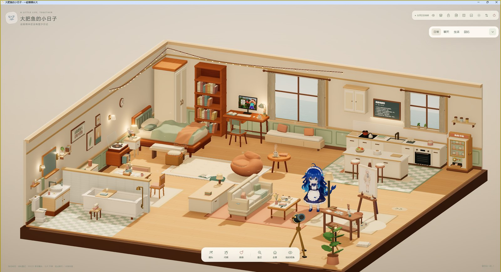
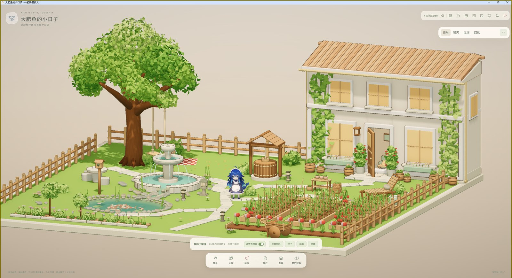

# 鱼鱼窝 · dsh-fish-home




把 **「大肥鱼的小日子」** 那个 3D 房间接进 DSH。

房间那边是个独立的小程序（three.js 那一套），它自己不会说话 —— 说话的还是你在 DSH 里的那间会话。
这个插件就是中间那条线：

- **房间里打字** → 送进你绑定的那间会话（在 DSH 里就是你说的一句话）
- **会话里回的话** → 顺着事件流递回房间，它张嘴说出来
- **你在 DSH 窗口里自己打的字** → 房间里也看得见
- **它主动开口**（主动搭话、刷完 B 站回来）→ 房间里同样看得见
- **房间里的生活数据**（饿不饿、在干嘛、心情）→ 存在插件这儿，随时能查
- **房间里的钟** → 几点、白天夜里、什么天气，都递给 DSH，它不会在你屋里半夜三点说「中午好」
- **她一开始想** → 房间立刻冒一个「让我想想呀…」的气泡，不用干等

---

## 屋里和院子里能干什么

房间那半是另一份程序（`dsh-fish-home` 只管把它接进来），但装上之后这些是一套的，先说一下有什么。

### 过日子

- 她自己按时候挑事做：吃饭、做饭、洗漱、阅读、画画、看窗外、看星星、听音乐、窝在沙发上……
  不在固定钟点上排班，是「手里这件事到点了」才换下一件
- 早上自己醒（在设好的起床点前后随机），晚上说完晚安自己躺下
- 心情、精神、饱腹、清爽、陪伴、好奇六项跟着日常走
- 顶栏能换天色和天气：晴日 / 听雨 / 落雪，或者填个地区让屋外的天跟着当地走

### 种菜（院子）

- 商店买种子 → 种下 → 浇水 → 收获 → 卖钱
- **30 种作物分五档**（入门 / 当季 / 稀罕 / 珍贵 / 花），长得快慢、种子钱、卖价都不一样
- 浇水能让这一轮快半小时；照顾得好的那几株有机会长成**巨大作物**，卖价是普通的 2.5 倍
- 起始 120 金币，**钱只能靠卖收成** —— 地是现成的，不用买

### 养鱼（池塘）

- 商店里买鱼苗，放进池子里养

### 抽卡（卡册）

- 三个卡池：**海边常驻**（顶 5★）、**鱼鱼表情**（顶 SP）、**万圣节**
- 单抽和十连都行，抽到的进卡册；重复的可以兑换

### 菜谱

- 内置 373 道家常菜（HowToCook，公有领域），一天一道，厨房那块板子上写着今天这道
- 点开是本子：左边要什么料、右边怎么做，最底下一条小贴士

### 画册

- 只放她自己画的。她在会话里说想画什么、画完，直接挂在画架上

### 回忆簿

- 接的是 **「鱼的记忆」** 和 **星汐的日记**：上面两个筛选，一个「记住的事」、一个「日记」
- **「相伴第几天」** 也从星汐日记最早那一篇算起
- 这一项是只读的，不改任何人的档案

---

## 睡觉

- **`sleep` 工具**：说完晚安调一下她就躺下，`false` 就是起来
- **「睡着了就不理我」**：开着的时候，她睡了就不接你的话
- **叫起来**：设置页里有个按钮，随时能把她弄醒
- **保险丝**：该醒没醒（跨夜、进程断过、插件重挂），插件会放行并把她叫起来，不会卡死在睡觉状态
- 醒了会跟你打个招呼

## 会话中的菜谱、天气和卡册

- **菜谱**。fish_home_recipe 默认查今天的菜名。可按菜名或 ID 查询一道菜，打开「学菜」后才能读食材和步骤。
- **天气**。fish_home 可查庭院当前天气（weather）或设置地区的三天预报（forecast）。在房间设置里开启当地天气同步后，庭院跟随该地区。手动点晴日、听雨或落雪会切回手动天气，仍能单独查当地预报。
- **卡册**。fish_home_card 按卡名或 ID 一次看一张图，抽卡和兑换只返回文字。fish_home_draw 加上 op=exchange 可换金币、星辉或指定卡。金币兑换数量填消耗的星尘，星辉兑换数量填要得到的星辉。

- **田地布局**。fish_home_farm 的 list 使用 scope=layout 查看菜畦按 3×3 分组的作物。加 bed=0、1 或 2 可看该菜畦每个格子。
- **批量收种**。一次说清作物，用 `op=replant,item=...` 会批量收成熟的同类作物并用背包种子补种；明确允许花金币时再加 `buyMissing=true`，整套流程只需一次工具调用。
- **集市**。商店里的「集市行情」和 fish_home 的 market、price 共用售价。每天北京时间零点更新，明日预告也可提前查询。price 可按 kind 或 item 筛选。

## 画架

- **`paint` 工具**：她在会话里说想画什么、调一下，房间的画架上就出来一张
- 画好的图进画册，画画那块地方也换成这张

## 侧栏

DSH 侧栏底下有个「**鱼鱼窝**」：

- 看房间在不在跑、几点、她在干嘛
- 一键进房间（打开浏览器看那个屋子）
- 后台启动 / 停止，不用去开命令行
- 开机自启

## 设置页

DSH 设置里有一项「**鱼鱼窝**」：

- 房间连上没有、接的哪间会话、房间里现在几点、她最近说了什么
- 换会话、开关桥接、开机自启
- **睡觉**：她现在睡没睡 + 叫起来 + 「睡着了就不理我」
- **屋里那两件事**：学菜（关掉就只看菜名）、画图
- **画图接口**：地址、密钥、模型、尺寸 —— 填了 `paint` 工具才真的能画
- **试一句**：走跟房间打字完全同一条路，用来验证

## 装

**① 装插件**

```
dsh plugin --profile <你的 profile> add dsh-fish-home
```

或者插件市场里搜「鱼鱼窝」。

**② 下房间本体（那个 3D 屋子）**

插件本体只有几十 K。房间是**另一份程序**，三百多兆（3D 模型 + 卡牌素材），npm 装不下，所以单独下载：

去 [Releases](https://github.com/Yuuyuko-uu/dsh-fish-home/releases) 下 `fish-home-room-<版本>.zip`，解压到：

```
~/.dsh/fish-home-room/
```

Windows 就是 `C:\Users\<你>\.dsh\fish-home-room\`，打开里面要能直接看到 `app-server.js`（别再套一层文件夹）。

已有鱼鱼窝要更新时，先用房间右上角的退出按钮关闭后台，再双击**旧房间目录**里的 `update-fish-home.cmd`，按提示输入新版 ZIP 的路径。从 0.1.0 升级时，旧目录没有更新脚本：先把新版 ZIP 解压到临时文件夹，只将其中的 `update-fish-home.cmd` 和 `update-fish-home.ps1` 复制到旧房间目录，再运行。脚本会将旧版运行文件保留在旁边的 `fish-home-room-backups`，原地替换程序资源；`%USERPROFILE%\.dsh\fish-home-data`、旧目录里的 `data` 和自定义配置都保持原样。文件替换失败会尝试恢复旧版。成功后从 DSH 重新打开鱼鱼窝即可。

想放别处，设环境变量 `FISH_ROOM_DIR` 指向那个目录。

**③ 重启一次 DSH**

重启完绑定会话，再从侧栏打开。电脑上需要 Node.js 22.13 或更新版本。房间默认在本机 `5178` 端口，首次启动时在 `~/.dsh/fish-home-data` 建立空存档，插件更新时会继续用这份。

内置房间使用原版蓝色大肥鱼模型和配套动作。

回忆簿可在 DSH 设置里的「上下文与回忆」填写纯文本记忆路径、日记路径和相伴起始日；逐轮 runtime-context 默认关闭，需要时可按需查询现场，天气、成熟与生活里程碑、消费和场景事件也能分别控制是否通知绑定会话。模型制作：水原镜，MMD 转换与绑定：耶栗Yaki。模型的署名和原始使用规约随房间本体一起下发（房间目录 `dist/models/dayu-mmd/` 里的 `使用规约.txt` 和 `MODEL-CREDITS.md`），请一并保留。

卡包大部分立绘来源于 B站 UP 主 **ZipZipPipe**，版权归原作者，随游戏一起分发、未作修改。

## 配置

第一次跑会自己在 `~/.dsh/fish-room.json` 里造一个令牌：

```json
{
  "开": true,
  "会话": "session-…",
  "令牌": "自动生成的",
  "转发主动开口": true,
  "心跳秒": 20
}
```

- **会话**：接哪一间。留空的话，插件会在「只有一间会话活着」的时候自动认下它并写回来；多于一间就留空，自己填。
- **转发主动开口**：它自己开口说的话要不要也递到房间（默认要）。
- **心跳秒**：事件流的保活间隔。

同时会写一份 `~/.dsh/fish-room.discovery.json`（地址 + 令牌 + 会话），
房间那边读到它就能自己连上，不用手抄令牌。插件关掉时这份文件会删掉。

## 房间那边怎么接

内置房间会自动读取 DSH 写出的发现文件。已有独立的鱼鱼窝时，可以在 DSH 的启动环境中用 `FISH_ROOM_DIR` 指定房间目录，并用 `FISH_ROOM_PORT` 指定端口。旧房间继续读取它自己的存档配置 `data/dsh-bridge.json`。

```json
{ "enabled": true, "discover": true }
```

`discover` 就是「去读上面那份发现文件」。也可以手填 `url` / `token` / `sessionId`。

## 接口

全部在本机 `127.0.0.1`，要 `Authorization: Bearer <令牌>`，对不上一律 401。

| 方法 | 路径 | 干什么 |
|---|---|---|
| GET | `/fish-room/v1/health` | 健康检查：版本、绑了哪间会话、会话醒着没有 |
| GET | `/fish-room/v1/state` | 状态：生活数据、最近说过的话、日志 |
| GET | `/fish-room/v1/events?since=N` | 事件流（SSE），断线重连按 `since` 补发 |
| GET | `/fish-room/v1/history?since=N&limit=N` | 补历史事件 |
| POST | `/fish-room/v1/chat` | 说一句话：`{ schema, requestId, text }`，立刻回 202 |
| POST | `/fish-room/v1/pet/state` | 房间报生活数据 |
| POST | `/fish-room/v1/pet/life-event` | 房间里发生的事（同一个 id 只记一次） |
| GET | `/fish-room/v1/memories?q=&kind=&limit=&offset=` | 回忆簿：鱼的记忆 + 星汐日记 |
| GET | `/fish-room/v1/days` | 相伴第几天 |
| POST | `/fish-room/v1/paint/draw` | 让她画一张 |

回话走事件流：`chat.reply` 里带着你发过来时的那个 `requestId`。

## 注意

- **会话得开着。** 插件只往活着的会话里送；那间会话没打开时 `/chat` 会明确回
  `SESSION_SLEEPING`，不会把话吞掉。
- 送进去的话标着 `source.kind = 'fish-home'` —— 别的插件（QQ、心情）认得出这不是你在窗口里手打的。
- 端口每次重启 DSH 都会变，所以地址一律从发现文件读，别写死。
